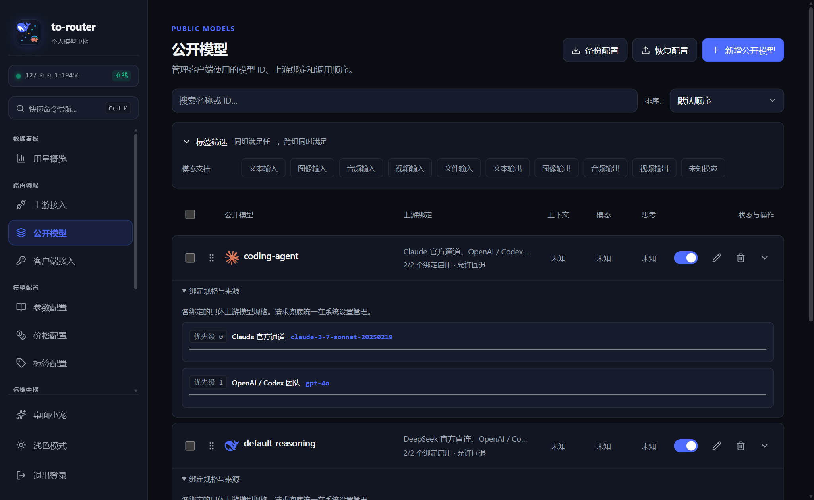
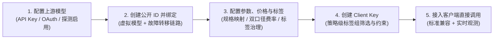
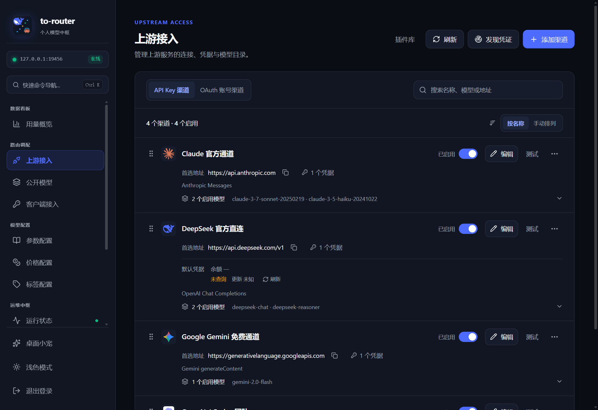
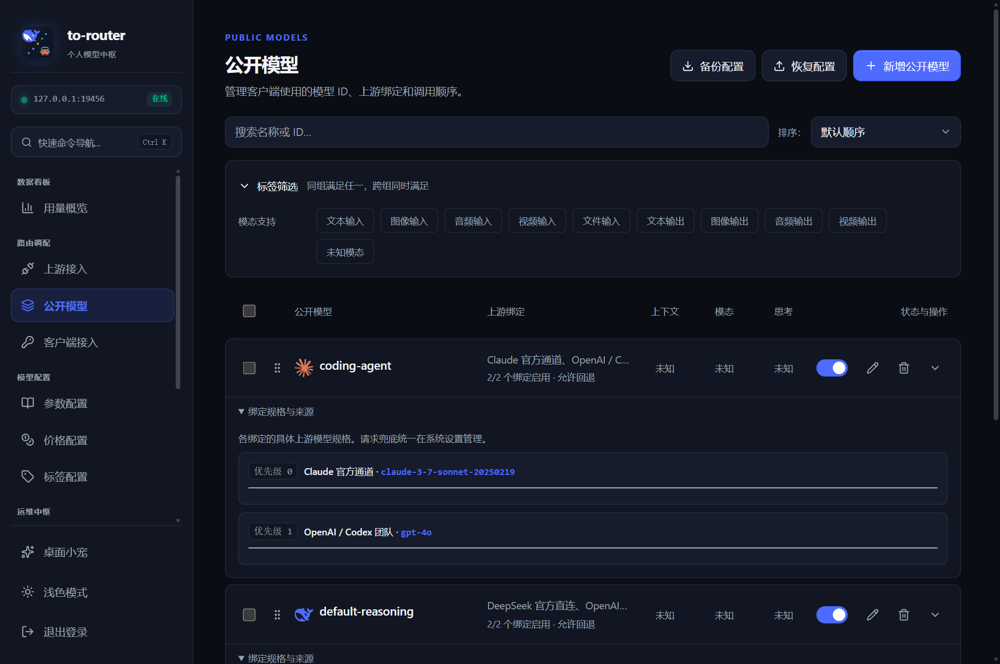
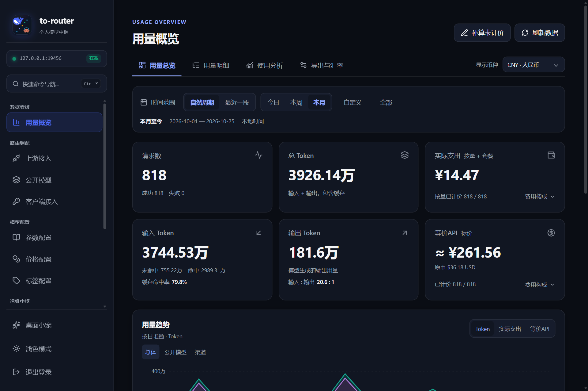

<div align="center">
  <h1>ToRouter</h1>
  
  <p><strong>面向个人的本地模型路由网关，统一管理模型接入、智能路由与用量支出。</strong></p>

  <p>
    <a href="https://github.com/TingnikuaiyuKeqing1120/ToRouter/releases/latest"></a>
    
    <a href="LICENSE"></a>
    
    
  </p>

  <p>
    <a href="#为什么做-torouter解耦与克制的设计理念">开发背景</a> •
    <a href="#核心亮点">核心亮点</a> •
    <a href="#兼容客户端与生态">兼容生态</a> •
    <a href="#快速开始">快速开始</a> •
    <a href="#核心场景">核心场景</a> •
    <a href="#常见问题与排查">常见问题</a> •
    <a href="#从源码构建">开发者构建</a> •
    <a href="#开源许可与致谢">许可与致谢</a>
  </p>
</div>

---

ToRouter 是一个专为个人开发者与 AI 高频使用者设计的本地模型路由网关。**单可执行文件，开箱即用，无需配置复杂的 Python/Node/Docker 外部环境**。支持把你的各类 API Key、平台订阅、第三方反代聚合在一起，统一封装为标准端点，无缝供给 Claude Code、Codex、Cherry Studio、NextChat、Cursor、Dify 等各类 AI 客户端使用。详细设计与使用介绍见 [微信公众平台](https://mp.weixin.qq.com/s/132EB3zPoC5hPedB36HTvg)。



---

## 为什么做 ToRouter：解耦与克制的设计理念

在日常使用大模型和各种 AI 工具时，我们经常遇到两难选择困境：

* **企业级分销工具（如 NewAPI / OneAPI 等）**：商业属性过强，充斥着多租户分权、充值计费、分销兑换等企业级包袱，个人在本地部署不仅笨重，还需维护额外的数据库与中间件。
* **桌面综合工具（如 CC Switch、Magpie 等）**：功能全面，但略显臃肿（部分功能过于罕用），且将模型路由与agent工具配置耦合。使用起来不甚顺心。

### 我们的原则：Unix 哲学与职责解耦
1. **纯粹面向个人自用**：彻底剥离多用户与商业化包袱。单 EXE、本地 SQLite 存储、数据 100% 留存在本地，0 外部依赖，下载即用。
2. **克制的功能设计：** 聚焦常见核心功能，并且渐进式披露，使得界面更加简洁，使用更加顺手。
3. **路由与客户端配置彻底解耦**：
   * **ToRouter 专注把模型网关做到极致**：负责多协议转换、智能容灾回退、多维度标签治理、精准双口径计量，以及**原生 MCP 自动化**。
   * **客户端配置交由专业工具负责**：不需要客户端配置的用户无需承受冗余负担；后续我们将推出配套的原生消费端工具 **MMA**（Manage My Agent），提供对 ToRouter 的原生支持与轻快配置。

---

## 核心亮点


### 一：面向 Agent 时代的自动化
* 🤖 **内置原生 MCP 运维中枢**：竞品中首个提供标准 MCP 服务（HTTP + Stdio 双通道）。不仅人可以通过控制台管理，**更让你的 Agent 成为网关的自动化管理员**。
  > **典型场景**：配合浏览器自动化 Agent（如 ego-lite）或定时任务，Agent 可以自主在社区或供应商处寻找最新优惠/高性价比渠道或免费额度，对比官方基准费率，并通过 MCP 自动将渠道与模型配置写入网关，实现“自动化寻源 + 自动配置”的闭环，告别手工搬运。
* 📚 **内置模型参数字典与一键下发**：内置全面且持续维护的大模型规格数据库。下游 Agent 或使用者获取标准化参数字段后可一键批量配置，省去翻阅各家冗长 API 手册的繁琐。
* 🏷️ **多维标签组与 Client Key 策略治理**：内置 `billing`（计费模式：free/plan/payg）与 `privacy`（数据隐私：zdr/log_no_train/train）等正交标签组。在生成客户端 API Key 时可指定硬性策略——例如：**隐私开发项目仅放行 `privacy:zdr`（零数据保留）渠道；后台批处理仅放行 `billing:free` 纯免费渠道**。

### 二：便捷好用的模型路由
* 🔄 **同渠道多协议自适应与无损互转**：统一支持 OpenAI Chat Completions、Responses、Anthropic Messages、Google Gemini generateContent 四大主流格式。支持在同一渠道混合配置不同协议端点，在严格子集内无损双向互转。
* 🛡️ **单一公开模型与智能透明故障转移**：对外暴露一个稳定的模型名称（如 `my-deepseek🐋`），后端可挂载多个渠道构成的优先级链路。
  >主力渠道遇到 5xx、限流或超时等故障时，网关在安全重试策略下自动降级至备选渠道；故障恢复后自动回正，客户端配置永远无需改动。同时，也可以无感升级（如对外暴露kimi-big，从k3升至k3.1pro时，仅需网关内部调整即可，客户端无感。）
* 📊 **双重定价模型与本地透明用量账本**：同时计算“渠道实际消费成本”与“对应官方 API 标准等价值”，支持多币种换算、阶梯定价与缓存节省统计，看清每一笔调用的真实性价比。

### 三：零迁移成本与轻量体验
* 🧲 **一键嗅探现有工具凭证（秒级平迁）**：自动扫描并导入本机已有的 CC Switch、Magpie 等工具的历史配置与 API Key，支持原生凭证文件及 Magpie 认证 JSON 往返导入导出，从旧环境迁移无缝丝滑。
* 🔌 **广泛直连反代与 Magpie 插件生态兼容**：内置支持各大官方直接接入、反代服务及特定订阅平台（如 Codex、Antigravity、Devin 等），全方位盘活你的各家订阅与免费额度；同时兼容 Magpie 生态扩展插件。
* 🦞 **可爱且实用的悬浮透明桌宠**：系统级无边框置顶透明桌面伴侣（Clawd 与蓝鲸），不仅是动态陪伴，更能实时显示当前流式输出速率（Tokens/s），并在控制坞中直接常驻监控官方 DeepSeek 原币余额与 Codex 额度窗口（后续会适配更多渠道）。

---

### 轻快上手
* **单 EXE 零外部依赖**：单个可执行程序内置 Web 管理台、原生桌面视图、CLI 日志流、悬浮桌宠与 MCP stdio，双击即用。
* **带数据库快照的安全原子更新与回滚**：内置 Ed25519 数字签名防篡改验证。升级前自动执行 SQLite 数据库与安全密钥快照；新版本启动若健康检查失败，辅助进程自动执行原子回滚，给基础设施级工具提供顶级安全感。

---

## 兼容客户端与生态

ToRouter 遵循严格的开放模型协议标准，无需私有 SDK，可作为各类 AI 开发工具与桌面客户端的统一驱动中心：

| 客户端类别 | 典型兼容工具 | 接入说明与场景 |
|---|---|---|
| **AI Coding Agents** | **Claude Code**、**Codex CLI**、**Cursor**、**GitHub Copilot**、**Aider**、**Devin** | 统一标准代理端点与鉴权，配合内置 MCP 甚至可让 Agent 自主代配置路由与查询渠道 |
| **桌面客户端与工作台** | **Cherry Studio**、**Chatbox**、**NextChat**、**LibreChat**、**LobeChat** | 填入 `http://127.0.0.1:17878/v1` 及 Client Key，一键拉取所有虚拟公开模型 |
| **应用编排与工作流** | **Dify**、**FastGPT**、**LangChain**、**LlamaIndex** | 自动故障重试与降级，保障长流程自动化不因单个上游 5xx / 限流而中断 |
| **原生生态协同** | **MMA（Manage My Agent，规划中）** | 原生与 ToRouter 深度集成，提供更加轻快高效的 Agent 配置与生态管理 |

---

## 快速开始

无需安装外部依赖或配置数据库，开箱即用：

1. **下载程序**：从 [GitHub Releases](https://github.com/TingnikuaiyuKeqing1120/ToRouter/releases) 下载最新的 `ToRouter.exe`。
2. **启动网关**：双击运行 `ToRouter.exe`。程序会常驻系统托盘，并自动在浏览器中打开 Web 管理控制台（默认地址：`http://127.0.0.1:17878`）。
3. **添加上游渠道**：在「上游接入」中添加你的供应商凭证（OpenAI、Anthropic、Gemini、DeepSeek 或兼容反代服务），勾选测试可用的模型。
4. **配置公开模型**：在「公开模型」中创建一个对外模型名称（例如 `default-reasoning`），并将其绑定到刚刚添加的上游模型；如有需要，可添加备用渠道作为第二优先级回退路线。
5. **客户端接入调用**：在「客户端接入」中生成一个客户端 API Key，按页面给出的指引，将客户端（如 Claude Code / NextChat）的 Base URL 填为：
   ```text
   http://127.0.0.1:17878/v1
   ```
   填入生成的 Key 与模型名，即可发起一次完整调用。

---

<h2 id="核心场景">核心场景：一次真实的使用流程</h2>

通过一次标准的使用流程，你可以快速上手并完整体验 ToRouter 的核心能力与设计细节：



### 1. 接入上游渠道与模型（上游接入）
> **目标**：把分散的官方 API Key、第三方反代或订阅平台（OpenAI、Anthropic、Gemini、DeepSeek、Codex 等）收敛为受控的网关渠道。



1. **添加凭证**：在「上游接入」点击添加渠道，选择协议格式（OpenAI / Anthropic / Gemini），填入你的 API Key、Base URL 或通过 OAuth 授权池连接官方订阅。
2. **探测并启用可用模型**：点击一键探测，从供应商拉取支持的模型列表，勾选你需要开放的模型（例如 `claude-opus-5-5`、`deepseek-flash`）。
3. **多凭证轮询与故障隔离**：支持单渠道内挂载多个 Key（支持故障顺移或轮询），异常时自动标记，保证出口稳定性。

---

### 2. 创建公开 ID 并绑定链路（公开模型）
> **目标**：给客户端暴露一个长期稳定的公开模型 ID，将具体供应商与底层物理链路在后端彻底解耦。



1. **设定公开 ID**：在「公开模型」新建对外模型名称，如统一的 `claude-opus-5-5`，或业务代号 `my-coder`、`fast-chat`。
2. **挂载上游优先级链路**：
   - **优先级 1（主力）**：绑定高性价比的第三方反代或自建代理；
   - **优先级 2（保底）**：绑定官方原厂直连或其他高可用渠道。
3. **透明故障转移**：客户端只需认准这一个固定 ID。当主力渠道遭遇 5xx、限流或网络超时等临时故障时，网关根据安全重试策略自动无感切换至下一优先级备用渠道；故障消除后自动回正，客户端配置永远无需改动。

---

### 3. 配置模型参数、价格与标签（精细化调校）
> **目标**：为接入的模型补齐原生能力规格字典、关联真实计费标准，并打上多维业务标签。

1. **参数配置（`ModelSpecs`）**：
   - 进入「参数配置」，网关内置持续维护的权威模型规格字典，可**一键匹配**补齐上下文窗口上限、原生模态能力（文本/图像/音频/视频）及思考模式（Native Thinking 档位）。
   - 可针对特定上游做原生字段映射与协议微调，省去人工查阅各家冗长 API 手册的麻烦。
2. **价格配置（`Prices`）**：
   - 进入「价格配置」，为渠道模型配置实际输入/输出/缓存单价，并自动关联官方基准费率。
   - 网关后续在用量账本中将自动计算“实际支出成本”与“对应官方 API 标准等价值”，让每一笔调用的真实性价比一目了然。
3. **标签配置（`Tags`）**：
   - 进入「标签配置」，不仅可以维护全局标签组（如计费模式 `billing:free/payg/plan`、数据隐私 `privacy:zdr/log_no_train`、场景分类 `scenario:coding/general`），更可在 **“模型标签配置”** 工作台中跨渠道查看与管理模型标签。
   - 支持单模型针对标签组设置独立覆盖，或批量统一分配标签、恢复跟随渠道默认，为下一步的安全访问治理做好准备。

---

### 4. 创建 Key 并按标签限定策略（客户端接入）
> **目标**：为下游客户端或开发项目生成专属 API Key，并基于标签建立细粒度的策略防火墙。

1. **生成客户端 Key**：在「客户端接入」点击“新建 Client Key”，为不同工具（如 Claude Code、Cursor、日常测试）分配独立名称。
2. **按标签筛选与策略约束**：
   - **隐私保护策略**：勾选仅允许访问 `privacy:zdr`（零数据留存）标签的上游渠道，包含商业核心代码的项目绝不会误走到带日志审计的上游；
   - **成本控制策略**：限定批量任务专用 Key 仅能走 `billing:free` 纯免费渠道，防止后台批处理产生意外巨额扣费；
   - **模型白名单**：精细勾选放行的公开模型范围，未授权模型直接在网关层隔离拦截。

---

### 5. 填入客户端直接使用（全生态开箱即用）
> **目标**：在任意标准 AI 客户端或自动化 Agent 中配置调用，观测实时吞吐与账本明细。



1. **填入标准端点**：在你的客户端（Cherry Studio、NextChat、Claude Code、Cursor 等）中，将 API 端点填为本地网关地址：
   ```text
   http://127.0.0.1:17878/v1
   ```
2. **发起调用与实时观测**：
   - 填入第 4 步生成的 Client Key 与第 2 步创建的公开模型 ID，立即发起一次完整调用。
   - 请求流经时，桌面小宠（Clawd / 蓝鲸）将实时展示流式吞吐速率（Tokens/s），并在控制坞中随时查看常用账号额度。
   - 调用完成后，在「用量账本」中即刻查看本次调用的 Token 明细、实际成本与官方等价对比，数据 100% 留存在本地 SQLite，安全又省心。

---

## 详细入口与排查指南

### 数据目录与配置迁移
* **数据存储**：默认数据与数据库保存在当前用户目录：`%USERPROFILE%\.to-router`。
* **自定义路径**：可通过启动参数 `-data` 自由指定，例如：
  ```powershell
  .\ToRouter.exe -data "D:\MyToRouterData"
  ```
* **备份与恢复**：管理台提供密码加密的完整配置导出（包含渠道、公开模型、价格规则与安全密钥），可在另一台机器或重装后一键导入恢复。

### 端口策略与固定地址说明
* 默认监听地址：`127.0.0.1:17878`。
* **端口固定不漂移**：若启动时端口被占用，程序会弹出明确错误提示并写日志，**不会静默更换为随机端口**（防止挂载在该端口的所有客户端无声失效）。
* **指定端口**：如遇端口冲突，可通过启动参数覆盖：
  ```powershell
  .\ToRouter.exe -port 18999
  ```

### 多视图切换与系统依赖
ToRouter 采用单 EXE 多子系统集成：
* **托盘单选**：右键系统托盘图标，在「默认启动方式」中可自由切换默认打开 **Web**、**Desktop** 或 **CLI** 视图。
* **桌面视图依赖**：Windows 原生桌面窗口依赖系统内置的 `WebView2` 运行时（Windows 10/11 通常已内置）。若环境缺失，可直接使用默认的 Web 模式（任何现代浏览器均可）。
* **CLI 日志模式**：控制台直接输出访问与转换日志流，按 `Ctrl+C` 退出控制台不影响后台服务的继续运行。

### 自动更新与安全防篡改
* 生产版构建内置数字签名验证（Ed25519 签名），后台检测到新版本时仅做轻量提示，绝不静默下载或强制升级。
* 升级前自动执行 SQLite 数据库与密钥安全快照。若新版本替换后健康检查失败，辅助进程会自动执行无感原子回滚，保障核心配置与凭证安全。

---

## 从源码构建

项目为标准 Go + React 架构，无外部特殊构建依赖。

### 环境准备
* Go 1.25+
* Node.js 20+ (包含 npm)
* Python 3.10+ (仅运行部分工程检查脚本)

### 构建命令
```powershell
# 1. 克隆代码仓库
git clone https://github.com/TingnikuaiyuKeqing1120/ToRouter.git
cd ToRouter

# 2. 一键编译完整单 EXE（含前端打包、第三方许可校验与资源嵌入）
.\build.ps1

# 编译产物位于根目录：ToRouter.exe
```

<details>
<summary><strong>运行内部测试与契约检查</strong></summary>

```powershell
# 运行 Go 单元测试（串行避免端口抢占）
go test -p 1 ./...

# 运行前端类型检查与单元测试
npm --prefix web run typecheck
npm --prefix web test

# 检查 MCP 契约与第三方声明一致性
.\scripts\check-mcp.ps1
python .\scripts\check-third-party.py --check
```
</details>

---

## 项目理念与问题反馈

* **个人用户优先**：拒绝臃肿的企业级分权与繁复概念，以最直白、顺手的交互满足个人模型路由的完整生命周期。
* **Simple is more**：常用路径直接可达，高级功能与协议微调折叠在抽屉与高级设置中。
* **反馈与交流**：
  * 欢迎在 [GitHub Issues](https://github.com/TingnikuaiyuKeqing1120/ToRouter/issues) 提交 Bug 报告、体验建议或新协议接入诉求。
  * 提交日志或截图反馈前，请务必注意**脱敏**个人的真实 API Key、自定义账号名或私有凭证。

---

## 开源许可与致谢

### 开源许可
ToRouter 自有代码采用 [MIT License](LICENSE) 授权开源。

第三方依赖组件及相应法律文本详见 [THIRD_PARTY_NOTICES.md](THIRD_PARTY_NOTICES.md)。

### 特别致谢与素材声明
* **Clawd 桌面伴侣形象**：基于开源项目 [clawd-on-desk](https://github.com/magpie-community/clawd-on-desk) 素材二创制作，素材保留其原始 [AGPL-3.0 许可证](scripts/companion/README.md) 及来源署名。
* **蓝鲸桌面伴侣形象**：为网络二创作品，原型设计灵感源自 DeepSeek 官方图标。本项目为个人非商业工具，如相关权利人有任何版权疑问或授权要求，请通过项目 Issues 与我们联系。
