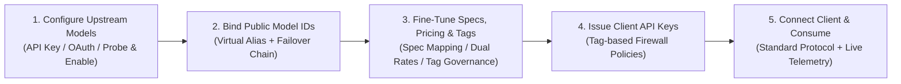

<div align="center">
  <h1>ToRouter</h1>
  
  <p><strong>A local-first AI model routing gateway for individuals. Unified model connectivity, smart failover routing, and transparent usage analytics.</strong></p>

  <p>
    <strong><a href="README_en.md">English</a></strong> • <strong><a href="README.md">中文简体</a></strong>
  </p>

  <p>
    <a href="https://github.com/TingnikuaiyuKeqing1120/ToRouter/releases/latest"></a>
    
    <a href="LICENSE"></a>
    
    
  </p>

  <p>
    <a href="#why-torouter-decoupled--restrained-design-philosophy">Background</a> •
    <a href="#core-highlights">Key Features</a> •
    <a href="#compatible-ecosystem--clients">Ecosystem</a> •
    <a href="#quick-start">Quick Start</a> •
    <a href="#core-scenario-a-real-world-walkthrough">Core Scenario</a> •
    <a href="#configuration--troubleshooting">Troubleshooting</a> •
    <a href="#building-from-source">Developer Guide</a> •
    <a href="#license--acknowledgments">License & Credits</a>
  </p>
</div>

---

ToRouter is a local-first AI model routing gateway crafted specifically for individual developers and high-frequency AI practitioners. **Delivered as a single portable executable, it works straight out of the box with zero runtime dependencies (no Python, Node.js, or Docker required)**. It seamlessly aggregates your diverse API keys, platform subscriptions, and reverse proxies into unified, standard endpoints for tools like Claude Code, Codex, Cursor, Cherry Studio, NextChat, Dify, and more. For an in-depth design walkthrough and usage guide, check out our [WeChat Official Account article](https://mp.weixin.qq.com/s/132EB3zPoC5hPedB36HTvg).


---

## Why ToRouter: Decoupled & Restrained Design Philosophy

When managing LLMs and AI workflows daily, developers often face an awkward dilemma:

* **Enterprise-grade Distribution Tools (e.g. NewAPI / OneAPI)**: Built for commercial resale, burdened with multi-tenant permissions, billing/recharge mechanisms, quotas, and affiliate systems. Running them locally is heavyweight and requires maintaining separate relational databases and middleware.
* **All-in-One Desktop Tools (e.g. CC Switch, Magpie)**: Comprehensive but bloated with rarely-used features, while tightly coupling model routing with agent client configurations, making the experience cluttered and inflexible.

### Our Principles: The Unix Philosophy and Clean Decoupling
1. **Built Exclusively for Personal Use**: Stripped of all multi-tenant and commercial overhead. A single lightweight executable, local SQLite storage, 100% of your data kept strictly on your machine, zero external dependencies. Download and run.
2. **Restrained, Focused UX**: Core paths are clean and immediate, with advanced protocol tweaks progressively disclosed to keep the interface fast, uncluttered, and ergonomic.
3. **Thorough Decoupling of Routing and Client Management**:
   * **ToRouter focuses exclusively on being an exceptional model gateway**: Multi-protocol lossless conversion, smart failover and recovery, orthogonal multi-dimensional tag governance, dual-metric valuation ledger, and **native MCP automation**.
   * **Client configuration belongs to dedicated consumption tools**: Users who don't need complex client configurations are not burdened. In the future, we will offer **MMA** (Manage My Agent) as a lightweight, native companion for fast agent orchestration.

---

## Core Highlights

### 1. Automation for the Agent Era
* 🤖 **Native MCP Hub (HTTP + Stdio Dual-Channel)**: The first model gateway to provide standard Model Context Protocol support natively. Beyond manual console controls, **your AI Agent can become an autonomous gateway administrator**.
  > **Typical Scenario**: Paired with browser automation agents (like ego-lite) or scheduled jobs, your agent can autonomously discover new model discounts, high-value channels, or free tiers across communities and vendors, evaluate them against official benchmark rates, and configure them directly into ToRouter via MCP—achieving a complete "auto-discovery + auto-configuration" loop without manual copy-pasting.
* 📚 **Built-in Model Spec Catalog & 1-Click Provisioning**: Ships with an authoritative, continuously maintained database of model specifications. Downstream agents or users can populate standardized parameter schemas with a single click, eliminating the need to browse lengthy provider API docs.
* 🏷️ **Multi-Dimensional Tag Governance & Client Key Policies**: Built-in orthogonal tag groups such as `billing` (`free` / `plan` / `payg`) and `privacy` (`zdr` / `log_no_train` / `train`). When generating client API keys, you can enforce rigid policy constraints—e.g.: **Privacy-sensitive codebases route strictly to `privacy:zdr` (Zero Data Retention) providers; background batch jobs route only to `billing:free` zero-cost tiers**.

### 2. Convenient & Resilient Model Routing
* 🔄 **Lossless Multi-Protocol Translation Across Providers**: Unified support for OpenAI Chat Completions, Responses, Anthropic Messages, and Google Gemini generateContent. Mix and match different protocol endpoints within the same upstream channel with lossless bi-directional conversion.
* 🛡️ **Single Public Model ID & Transparent Failover**: Expose a single, stable virtual model name (e.g., `my-deepseek🐋`) to downstream clients, backed by a prioritized chain of upstream providers.
  > When the primary channel encounters 5xx server errors, rate limits, or timeouts, the gateway automatically and safely downgrades to secondary providers without interrupting the client. Once the primary recovers, the gateway seamlessly reverts back. You can also upgrade models behind the scenes (e.g., pointing `kimi-big` from `k3` to `k3.1pro`) with zero client-side reconfiguration.
* 📊 **Dual-Metric Pricing & Transparent Local Ledger**: Computes both "actual provider cost" and "equivalent official benchmark API valuation" simultaneously. Features multi-currency conversion, tiered pricing, and prompt-caching savings analytics, providing complete transparency into the true cost-efficiency of every invocation.

### 3. Zero Migration Friction & Delightful Experience
* 🧲 **One-Click Credential Sniffing (Instant Migration)**: Automatically scans and imports existing configurations and API keys from local tools like CC Switch and Magpie. Supports native credentials and Magpie JSON round-trip import/export for seamless migration.
* 🔌 **Direct Provider Support & Magpie Plugin Ecosystem Compatibility**: Supports official direct APIs, third-party proxies, and subscription platforms (Codex, Antigravity, Devin, etc.) out of the box, maximizing the utility of your subscriptions and free quotas, alongside full compatibility with the Magpie plugin ecosystem.
* 🦞 **Delightful & Functional Floating Desktop Companions**: Borderless, top-level, transparent desktop companions (Clawd and Blue Whale). Far more than just visual buddies, they display live streaming throughput (Tokens/s) in real time and monitor DeepSeek balance and Codex quota windows directly inside the dock.

---

### Effortless Operation
* **Single Portable Executable**: Integrates the Web management console, native Windows desktop view, CLI log stream, floating desktop pet, and MCP stdio engine into one single binary.
* **Atomic Updates with Cryptographic Snapshots & Auto-Rollback**: Built-in Ed25519 digital signature verification prevents tampering. Automatically captures SQLite database and security credential snapshots before any update. If a newly installed version fails health checks upon startup, the helper process automatically executes an atomic rollback, ensuring infrastructure-grade reliability.

---

## Compatible Ecosystem & Clients

ToRouter adheres strictly to open AI model protocol standards without requiring proprietary client SDKs. It serves as a unified driver hub for various AI developer tools and desktop clients:

| Client Category | Typical Tools | Integration & Scenarios |
|---|---|---|
| **AI Coding Agents** | **Claude Code**, **Codex CLI**, **Cursor**, **GitHub Copilot**, **Aider**, **Devin** | Unified standard proxy endpoints and authentication. Paired with native MCP, coding agents can even autonomously configure routes and query available models. |
| **Desktop Clients & Workbenches** | **Cherry Studio**, **Chatbox**, **NextChat**, **LibreChat**, **LobeChat** | Point the base URL to `http://127.0.0.1:17878/v1` with your Client Key to pull all virtual public models instantly. |
| **Workflow & Agent Orchestration** | **Dify**, **FastGPT**, **LangChain**, **LlamaIndex** | Automatic retries and failover keep long-running multi-step automations running smoothly without failing due to upstream 5xx / rate limits. |
| **Native Ecosystem Synergy** | **MMA (Manage My Agent, planned)** | Natively and deeply integrated with ToRouter, delivering an ultra-lightweight and ergonomic agent configuration and lifecycle management suite. |

---

## Quick Start

No external dependencies or database setups needed—ready to use in seconds:

1. **Download**: Grab the latest `ToRouter.exe` from [GitHub Releases](https://github.com/TingnikuaiyuKeqing1120/ToRouter/releases).
2. **Launch**: Double-click `ToRouter.exe`. The application docks into your system tray and automatically opens the Web console in your browser (default URL: `http://127.0.0.1:17878`).
3. **Add Upstream Channels**: Under "Upstream Channels", add your provider credentials (OpenAI, Anthropic, Gemini, DeepSeek, or compatible reverse proxies) and probe for available models.
4. **Create a Public Model**: Under "Public Models", define a public-facing virtual model ID (e.g., `default-reasoning`) and bind it to your upstream model; attach backup channels as secondary priorities if desired.
5. **Issue a Client Key**: Under "Client Access", create an API key. Configure your client (e.g., Claude Code, Cursor, or NextChat) with the standard endpoint:
   ```text
   http://127.0.0.1:17878/v1
   ```
   Provide the generated key and model ID to start dispatching requests immediately.

---

<h2 id="core-scenario-a-real-world-walkthrough">Core Scenario: A Real-World Walkthrough</h2>

Follow this end-to-end workflow to quickly get up to speed with ToRouter's core capabilities and design nuances:



### 1. Configure Upstream Channels & Models (Upstream Channels)
> **Goal**: Consolidate disparate API keys, third-party proxies, and subscription platforms (OpenAI, Anthropic, Gemini, DeepSeek, Codex, etc.) into controlled gateway channels.


1. **Add Credentials**: In "Upstream Channels", click "Add Channel", choose the protocol format (OpenAI / Anthropic / Gemini), enter your API Key, Base URL, or connect official subscriptions via OAuth token pools.
2. **Probe & Enable Available Models**: Click the one-click probe button to fetch supported models directly from the provider, and check the models you want to activate (e.g., `claude-opus-5-5`, `deepseek-flash`).
3. **Multi-Credential Rotation & Isolation**: Supports attaching multiple API keys within a single channel (with automatic error failover or round-robin rotation). Faulty credentials are automatically isolated to ensure consistent uptime.

---

### 2. Create Public Model IDs & Routing Chains (Public Models)
> **Goal**: Expose stable, long-lived public model IDs to clients while thoroughly decoupling specific providers and underlying physical connections in the backend.


1. **Define a Public Model ID**: In "Public Models", create a stable virtual model identifier, such as standard `claude-opus-5-5`, or task aliases like `my-coder` or `fast-chat`.
2. **Attach Prioritized Upstream Chains**:
   - **Priority 1 (Primary)**: Bind a cost-effective third-party proxy or private gateway.
   - **Priority 2 (Fallback)**: Bind an official direct API or high-availability provider as a safety net.
3. **Transparent Failover**: Downstream clients only communicate with this single ID. When the primary provider encounters temporary 5xx errors, rate limits, or timeouts, the gateway automatically retries and shifts to secondary routes without breaking the request. Once healthy, it smoothly transitions back.

---

### 3. Fine-Tune Specs, Pricing & Tags (Precision Tuning)
> **Goal**: Enrich models with native capability metadata, associate real billing rates, and classify models with orthogonal operational tags.

1. **Model Specs (`ModelSpecs`)**:
   - In "Model Specs", leverage the built-in, curated model dictionary to **auto-match** context window limits, native modalities (text/image/audio/video), and native thinking modes.
   - Customize parameter overrides and protocol fine-tuning per upstream model without digging through provider documentation.
2. **Pricing & Rates (`Prices`)**:
   - In "Pricing", set actual input, output, and caching rates per model, and link them to official benchmark prices.
   - The gateway automatically calculates both "actual expenditure" and "official benchmark valuation" in the usage ledger, providing clear insight into true cost performance.
3. **Tag Governance (`Tags`)**:
   - In "Tags", manage global tag groups (e.g., billing modes `billing:free/payg/plan`, data privacy `privacy:zdr/log_no_train`, and scenarios `scenario:coding/general`).
   - Use the **"Model Tag Workbench"** to view and manage model tags across all channels, apply custom overrides, or bulk-assign policies.

---

### 4. Issue Keys with Tag-Based Firewall Policies (Client Access)
> **Goal**: Generate dedicated API keys for downstream clients and projects while enforcing fine-grained policy firewalls based on tags.

1. **Generate Client Keys**: In "Client Access", click "New Client Key" and assign distinctive names for different tools (e.g., Claude Code, Cursor, Daily Testing).
2. **Enforce Tag & Model Constraints**:
   - **Privacy Policy**: Restrict a key to `privacy:zdr` (Zero Data Retention) upstream providers, ensuring proprietary code never reaches logging-enabled channels.
   - **Cost Control Policy**: Constrain batch jobs to `billing:free` zero-cost tiers, eliminating unexpected billing spikes.
   - **Model Whitelist**: Restrict keys to explicit public model subsets; unauthorized requests are rejected immediately at the gateway layer.

---

### 5. Connect Clients & Consume (Instant Ecosystem Compatibility)
> **Goal**: Configure standard AI clients or autonomous agents to start making calls, observing real-time streaming speeds and ledger analytics.


1. **Configure Standard Endpoint**: In your client (Cherry Studio, NextChat, Claude Code, Cursor, etc.), set the API base URL to:
   ```text
   http://127.0.0.1:17878/v1
   ```
2. **Invoke & Observe in Real Time**:
   - Enter your Client Key and public model ID to make a call.
   - While streaming, the floating desktop companion (Clawd / Blue Whale) displays live generation speed (Tokens/s) on your desktop.
   - Review token counts, cache savings, actual costs, and official valuation comparisons in the "Usage" ledger, with 100% of telemetry stored locally in SQLite.

---

## Configuration & Troubleshooting

### Data Directory & Storage Migration
* **Default Directory**: Data, configurations, and SQLite databases are stored in the user profile: `%USERPROFILE%\.to-router`.
* **Custom Location**: Specify a custom path via the `-data` CLI flag:
  ```powershell
  .\ToRouter.exe -data "D:\MyToRouterData"
  ```
* **Encrypted Backup & Restore**: The Web console supports password-encrypted full configuration exports (channels, public models, pricing rules, and keys) for effortless migration and disaster recovery.

### Port Strategy & Fixed Addressing
* Default listening address: `127.0.0.1:17878`.
* **Strictly Fixed Port**: If the port is already occupied at startup, the program halts with an explicit error dialog and log entry. It **never quietly binds to a random fallback port**, preventing all downstream clients from silently breaking.
* **Overriding Port**: Override the port via the command-line flag:
  ```powershell
  .\ToRouter.exe -port 18999
  ```

### Multi-View Architecture & System Dependencies
ToRouter packages multiple presentation modes inside a single executable:
* **System Tray Switcher**: Right-click the tray icon to choose your preferred default view (**Web**, **Desktop**, or **CLI**).
* **Desktop View Dependency**: The native Windows desktop window relies on the built-in Windows `WebView2` runtime (pre-installed on Windows 10/11). If unavailable, the default Web mode runs in any modern browser.
* **CLI Logging Mode**: Prints live request and protocol conversion streams to the console. Pressing `Ctrl+C` closes the console view without stopping the background gateway daemon.

### Automatic Updates & Tamper-Proof Cryptography
* Production builds verify Ed25519 digital signatures. When an update is detected, a subtle indicator appears—it never downloads or restarts silently without user action.
* Update packages trigger automatic SQLite and key security snapshots before replacement. If health verification fails on startup, the helper process automatically rolls back.

---

## Building from Source

ToRouter follows a standard Go + React architecture with zero specialized native build tools.

### Prerequisites
* Go 1.25+
* Node.js 20+ (with npm)
* Python 3.10+ (for engineering verification scripts)

### Build Command
```powershell
# 1. Clone the repository
git clone https://github.com/TingnikuaiyuKeqing1120/ToRouter.git
cd ToRouter

# 2. Compile the all-in-one executable (bundles frontend, checks third-party notices, embeds assets)
.\build.ps1

# The output executable is placed at the root: ToRouter.exe
```

<details>
<summary><strong>Running Internal Tests & Contract Verifications</strong></summary>

```powershell
# Run Go unit tests sequentially (prevents port collisions)
go test -p 1 ./...

# Run frontend type checking and unit test suite
npm --prefix web run typecheck
npm --prefix web test

# Verify MCP protocol contracts and third-party notices
.\scripts\check-mcp.ps1
python .\scripts\check-third-party.py --check
```
</details>

---

## Philosophy & Community Feedback

* **Individual-First**: We reject bloated enterprise abstractions and multi-tenant complexity, focusing purely on delivering the most direct, ergonomic lifecycle for personal model management.
* **Simple is More**: Primary workflows are immediately accessible; advanced overrides and protocol tuning are tucked cleanly into expandable drawers and secondary panels.
* **Feedback & Support**:
  * We welcome bug reports, feature suggestions, and new protocol requests via [GitHub Issues](https://github.com/TingnikuaiyuKeqing1120/ToRouter/issues).
  * Please remember to **redact** personal API keys, private tokens, or proprietary credentials before sharing logs or screenshots.

---

## License & Acknowledgments

### Open Source License
ToRouter's original source code is licensed under the [MIT License](LICENSE).

Third-party dependencies and their corresponding licenses are detailed in [THIRD_PARTY_NOTICES.md](THIRD_PARTY_NOTICES.md).

### Special Acknowledgments & Asset Attribution
* **Clawd Desktop Companion**: Derived from the open-source project [clawd-on-desk](https://github.com/magpie-community/clawd-on-desk), preserving its original [AGPL-3.0 License](scripts/companion/README.md) and attribution.
* **Blue Whale Desktop Companion**: Community derivative artwork inspired by the official DeepSeek brand logo. ToRouter is a non-commercial personal tool; copyright holders are welcome to contact us via GitHub Issues for any licensing inquiries.
